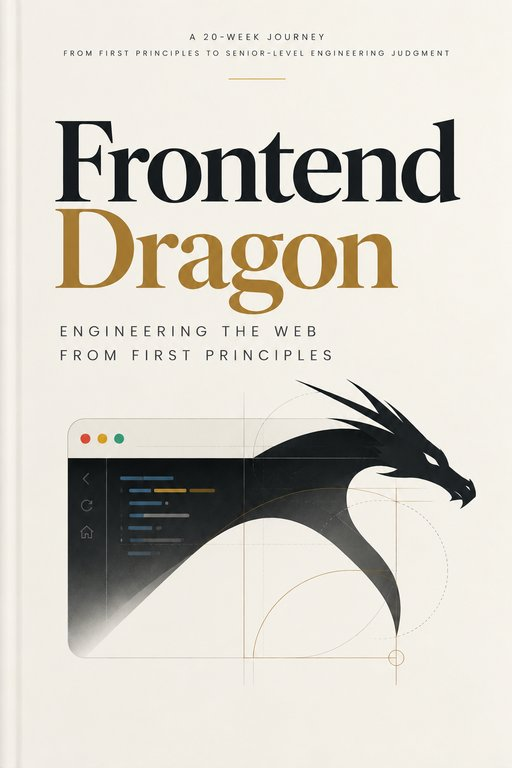

# Frontend Dragon



*Engineering the Web from First Principles* — a systems-oriented book for experienced
frontend engineers. This repository holds the manuscript, the context that keeps
AI-assisted chapter writing consistent, and the pipeline that builds the book as a PDF
and as a static website from one Markdown source.

```
book/
  manuscript/            the book, one Markdown file per chapter (+ front matter)
  context/               everything a writing session needs instead of re-reading chapters
production/
  build.py               CLI: pdf | site | lint  (--fixture for design sessions)
  fd/                    shared converter + the two targets
  book.css               print design (WeasyPrint paged media)
  site.css               web design (same tokens, light/dark, responsive)
  fixture/               a 1,500-word manuscript that exercises every device
  fetch-fonts.sh         downloads the three typefaces (not committed)
  DESIGN-GUIDELINES.md   manuscript conventions + design rationale for both targets
AGENTS.md                instructions and memory for AI agents working on this repo
Makefile                 the commands below
```

## Building on a fresh machine

Requirements: Python 3.10+, `pip`, and for the PDF target the native libraries WeasyPrint
needs (Pango, Cairo, GDK-PixBuf). For visual QC, `poppler-utils` (`pdftoppm`).

```bash
# macOS
brew install python pango cairo gdk-pixbuf libffi poppler
# Debian / Ubuntu
sudo apt install python3-pip libpango-1.0-0 libpangoft2-1.0-0 libcairo2 libgdk-pixbuf-2.0-0 poppler-utils

make setup      # pip install -r production/requirements.txt
make fonts      # downloads Source Serif 4, Source Sans 3, JetBrains Mono into production/fonts/lib/
```

## Commands

| Command | Result |
|---|---|
| `make pdf` | `out/Frontend-Dragon.pdf` |
| `make site` | `out/site/` — open `out/site/index.html`, or `make preview` for http://localhost:8000 |
| `make all` | both |
| `make lint` | fails if any fenced block is wider than the print measure allows |
| `make fixture-pdf` / `make fixture-site` | build from `production/fixture/` (fast; for design and pipeline work) |
| `make contact-sheet` | thumbnails of every PDF page in `out/pg/` for a visual check |
| `make clean` | remove `out/` |

Everything under `out/` and the downloaded fonts are git-ignored. The site is plain
static files: copy `out/site/` to any static host.

## Working on the book

There are two kinds of session and they should not be mixed:

- **Content sessions** write or revise a chapter. They read `book/context/` and touch
  only `book/`. They never need `production/`.
- **Design / pipeline sessions** change how the book looks or builds. They touch only
  `production/` and build against the fixture, never a real chapter.

`AGENTS.md` has the exact procedure for each, written for AI agents but equally usable
by a human. The manuscript conventions the build depends on (chapter header comments,
device spellings, code width limits) are in `production/DESIGN-GUIDELINES.md`.

## Status

| Part | State |
|---|---|
| Front matter | drafted |
| Chapter 1 — The Browser as a System | drafted, reviewed |
| Chapters 2–20 | see `book/context/CHAPTER-SPECS.md` |
| PDF pipeline | working |
| Web reading surface | working (light/dark, mobile, per-chapter pages) |
| Web interactive layer (experiments, labs, live diagrams) | planned, see `AGENTS.md` |

## License

Manuscript and design: all rights reserved (draft). Typefaces are under their own open
licenses (SIL OFL) and are downloaded, not vendored.
